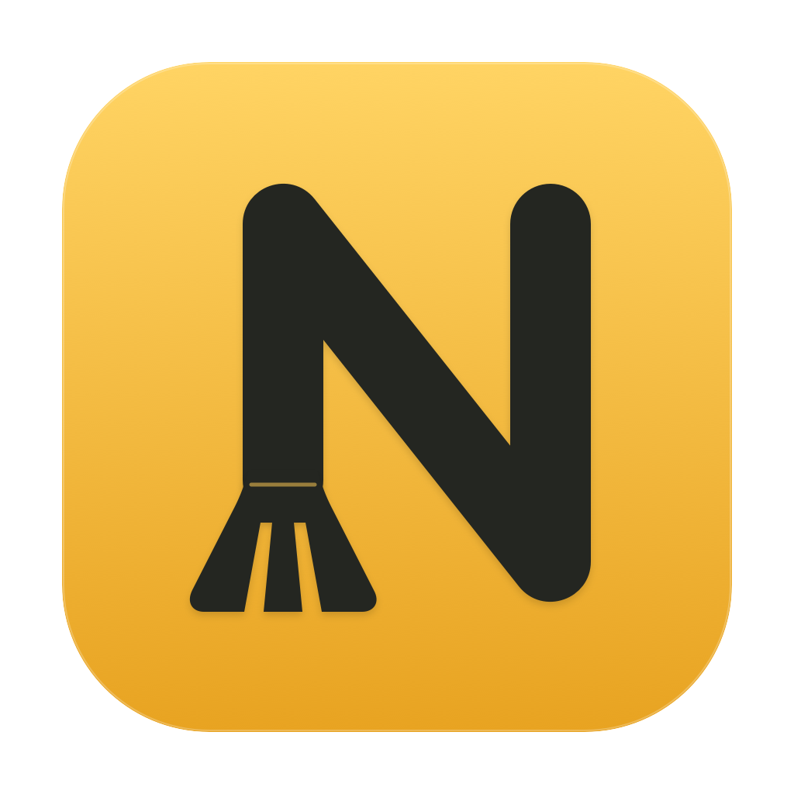

# NookSweep



NookSweep 是以 SwiftUI 製作的 macOS 清理與狀態監測工具。先查看路徑與內容狀態，再選擇要移到垃圾桶的資料；所有掃描與系統指標都在本機處理，沒有遙測。更新檢查只向 GitHub 讀取公開版本資訊，不傳送掃描結果或對話內容。

使用 Swift、Foundation 與 macOS 系統框架，無第三方相依套件，以 [MIT 授權](LICENSE) 開源。

目前版本為 1.8.2（build 16）。

## 功能

- 掃描應用程式快取、舊記錄檔、開發工具快取與明確列出的 AI 工具暫存。
- 分類搜尋、查看大小與完整路徑、在 Finder 顯示、逐項選取與清理結果回報。
- 一般列表與 AI 分組提供「最近修改」日期欄位，可切換日期或大小排序；對話與本機歷史可篩選 15／30／60 天以前的資料。
- AI 工具與資料類型群組各有「全選可整理」，只加入符合目前篩選的可整理項目；切換分類或搜尋保留既有選取，篩選外的已選數量會明確提醒。執行中提示包含背景程序，並標示上次掃描偵測到的工具。
- 「開發工具快取 → AI 工具清理」依工具及資料類型分組，列出快取、工具版本、對話、本機歷史與工作副本，並顯示可整理／保留數量及原因；可直接全選目前篩選範圍內的可整理項目，包含收合群組。
- 工作副本預設只允許整理乾淨、已合併且超過閒置門檻的項目；另提供手動整理選項，預覽含變更、未合併或近期使用的工作副本，再另行確認。
- 軟體移除可預覽 App 大小、版本與路徑，選擇只移除 App，或另外勾選可精確對應的相關資料；執行中的第三方 App 可另行確認結束或強制結束後移除。
- 軟體移除先嘗試系統搬移，遭權限拒絕時再請 Finder 處理同一個已確認項目；首次可能要求允許控制 Finder，並可能出現管理員驗證視窗。App 未移除時會保留相關資料；權限失敗會列出錯誤來源與代碼，系統仍可拒絕受保護的項目。
- 狀態頁與選單列面板：CPU 與每核心使用率、記憶體與壓力、磁碟可用量、網路速率、電池、開機時間及高記憶體程序。
- 每 2 秒更新系統指標，可暫停、繼續、手動更新及查看短期趨勢。
- 原生使用說明視窗，涵蓋清理、AI、軟體移除、權限、還原與更新，不需另開 README。
- 新版下載提醒：啟動或回到前景時每 24 小時最多檢查一次，可關閉或手動檢查，前往 GitHub 發布頁下載。

## 開啟與使用

側欄、選單列與「輔助說明 → NookSweep 使用說明」（⌘⇧/）可開啟軟體內的說明視窗。選「更新與版本」可查看目前版本、檢查結果及自動檢查開關；也可從「NookSweep → 檢查更新…」直接開啟。

自動檢查預設開啟，啟動或回到前景時每 24 小時最多讀取一次 GitHub 公開 latest release。只接受較新的正式版本，發現新版會在主視窗與選單列顯示「下載更新」。關閉提示後不重複提醒同一版本，仍可手動檢查再次查看；之後有更高版本會再提示。離線或 GitHub 暫時失敗時，自動檢查不打斷操作，手動檢查會顯示可重試的說明。

按下載會開啟官方 GitHub 發布頁，由使用者下載並安裝；不自動下載、執行或覆寫 App。更新後若 macOS 要求重新允許 App 管理，請重新選取更新後的 NookSweep。更新檢查不使用 GitHub 登入或權杖，不傳送檔案清單、對話、系統指標或使用者識別；可在軟體內關閉自動檢查。

從 [GitHub Releases](https://github.com/jacky100888/NookSweep/releases) 下載 Universal2 版 App。同一份 ZIP 內含 `arm64` 與 `x86_64`，支援 Apple Silicon（M 系列）與 Intel Mac。

兩種架構都需要 macOS 14 以上。開啟 `NookSweep.app`，也可以將它移到「應用程式」。自行建置時，預設也會產出包含兩種架構的 Universal2 App。

側欄「即時狀態」提供完整指標；選單列的波形圖示提供簡短面板。關閉主視窗後仍可從選單列查看、暫停監測、重新開啟主視窗或結束 App。

1. 在側欄選「全部項目」；若要整理 AI 資料，選「開發工具快取」並切換為「AI 工具清理」，再按「開始掃描」。掃描只會讀取檔案，可隨時取消。
2. 依分類或名稱篩選，點選項目查看完整路徑、大小、最近修改時間與保留原因。
3. 先結束相關應用程式、AI CLI、建置與套件安裝工作，再勾選要清理的項目。
4. 按「移到垃圾桶」並確認。App 會重新驗證路徑與狀態，再逐項回報成功或保留原因。

「開發工具快取」頁內提供「一般快取／AI 工具清理」模式切換，側欄不再獨立列出 AI 項目。AI 模式的資料類型可選全部、快取暫存、對話與本機歷史、舊版本或工作副本。切換清理模式會取消選取；若已有掃描結果，會重新掃描，避免混用不同範圍的結果。

預設不勾選任何項目。「AI 工具清理」列表提供「全選可整理」與「取消全選」；全選依目前搜尋與資料類型範圍，只勾選可整理項目，包含收合群組內的項目。切換資料類型或日期篩選後會保留已選項目，底部顯示完整選取總量；「取消全選」會清除已選項目。對話與本機歷史仍會列出，但需先在 AI 頁內開啟「允許整理舊對話／歷史」才可選取；這個設定只在全部或對話與本機歷史類型顯示，全選不會略過設定或其他保留規則。歷史與工作副本在操作前另行確認。「軟體移除」使用獨立的 App 預覽與確認流程。

一般列表可點「最近修改」或「大小」欄頭切換排序；AI 列表保留工具／類型分組，欄頭排序作用於群組內。日期是檔案及關聯資料的最近修改時間，不是訊息內的對話日期；未取得日期的項目在日期排序時置底。

選擇「對話與本機歷史」資料類型後，可篩選全部日期、15 天以前、30 天以前、60 天以前，以掃描完成時間為基準；未知日期只在全部日期顯示。篩選只改變顯示與全選範圍，已選項目仍保留。歷史清理門檻仍為至少閒置 30 天，15～29 天資料只供查看，索引管理或其他受保護內容也不會因此開放整理。

資料移到垃圾桶後仍占用磁碟；清空垃圾桶才會釋放空間。App 不會清空垃圾桶。需要取回時，請從垃圾桶將項目移回原路徑；若應用程式已產生同名資料，先結束它並確認要保留的版本。

## 清理範圍

| 分類 | 範圍 | 最低閒置天數 |
| --- | --- | --- |
| 應用程式快取 | `~/Library/Caches` 的直接子項目 | 7 天 |
| 舊記錄檔 | `~/Library/Logs` 的直接子項目 | 30 天 |
| 開發工具快取 | Xcode DerivedData、npm、pip、uv、Gradle 的明確快取目錄 | 7 天 |
| AI 工具暫存 | Codex、Claude、Gemini、OpenCode 的明確快取與記錄檔，以及 Codex、Claude、Cursor、ChatGPT 等已辨識的 App 快取葉節點 | 7 天 |
| 對話與本機歷史 | 已知對話檔案與 Cursor 本機歷史；預設列出並保留，開啟允許整理後才可選取 | 30 天 |
| AI 工具版本 | 已確認早於目前使用版本的 Claude Code 版本檔 | 7 天 |
| AI 工作副本 | 通過 Git 路徑與登記驗證的 Codex linked worktree；預設須乾淨且已合併，手動整理可放寬內容狀態 | 預設 7 天；手動整理可略過 |

開發工具路徑為 `~/Library/Developer/Xcode/DerivedData`、`~/.npm/_cacache`、`~/.cache/pip`、`~/.cache/uv`、`~/.gradle/caches`。

AI 暫存包括 `~/.claude/debug`、`~/.claude/paste-cache`、`~/.claude/shell-snapshots`、`~/.codex/log`、`~/.codex/shell_snapshots` 與 `~/.gemini/logs`。這些目錄可能含提示文字或診斷資訊，清理前仍應查看項目。

### AI 工具清單與歷史

「AI 工具清理」在已知路徑內完整列出可辨識項目，依工具及資料類型分組；統計包含目前資料類型的全部項目，搜尋與「只顯示可整理」只影響列表。無法量測的項目會明確標示。清單不代表整個磁碟的所有 AI 資料。

App 快取只接受已確認的 `Cache`、`Code Cache`、`GPUCache` 與 Service Worker 快取等葉節點，包含已知 profile／partition 布局；不將整個 Application Support 視為快取。Codex 的 `~/.codex/cache` 與 `~/.codex/.tmp` 也依已知結構辨識，未知項目保留。

歷史清單只辨識已知路徑、檔名及必要中繼資料，不讀取訊息或快照正文：

- Claude CLI：專案目錄內的已知 JSONL 對話檔，以及已知結構的子代理紀錄；不搬移整個專案資料夾。
- Gemini CLI：`~/.gemini/tmp/<project>/chats/session-*.json`。
- Codex：列出 sessions 與 archived sessions 的 `.jsonl`／`.jsonl.zst`，不解壓縮對話正文。紀錄受資料庫索引管理，全部保留並禁止清理；全選與允許整理歷史也不會選取。請由 Codex 管理，官方永久刪除操作不納入本工具的垃圾桶流程；封存只改變紀錄位置，不會釋放對話檔案空間。
- Cursor：只列出 `~/Library/Application Support/Cursor/User/History/<hash>` 的本機歷史 record；每個 record 整組處理，必要時只讀 `entries.json` 取得原檔名，不影響工作區原始檔或聊天。
- OpenCode：舊式 `storage/session/<project>/ses_*.json` 會連同對應的 message、part、session_diff 與 todo 分組。新版資料庫僅列出並保留；資料庫與舊紀錄並存、session 命名空間含連結、識別碼重複或布局未知時，舊紀錄也保留。

舊對話與本機歷史無法重新產生，移除後可能失去聊天內容、接續工作的上下文或檔案快照。AI 對話與快取整理不以設定、登入憑證、skills、rules、記憶、專案原始碼及 SQLite 主檔／WAL／SHM 作為清理目標；使用者選定的工作副本則依下方規則，連同其專屬 Git 管理目錄整組移到垃圾桶，不搬移原儲存庫。

### OpenCode 快取與資料

支援 CLI 預設的使用者資料位置，沿用 7 天閒置門檻與清理前重新驗證。可辨識的 OpenCode 執行中時，包含桌面版的 `opencode-cli` 背景服務，相關快取會保留。

- `~/.cache/opencode/models.json`：可重新下載的模型清單。其他直接子項會列出並保留，包含工具安裝、外掛相依套件、manifest 與 `version`；單獨移除這些內容可能破壞外掛安裝狀態或觸發整個快取重建。
- `~/.local/share/opencode/log`：逐一列出舊版時間戳／`dev.log` 與新版 `opencode.log`／`opencode-<channel>.log`。未知檔名與子目錄保留。
- `~/.local/share/opencode/tool-output`：逐一列出已知 `tool_` 識別碼格式的一般檔案。逾期輸出可能包含工具回覆內容，移除後無法再次讀取這份完整輸出；未知格式保留。
- `~/.local/share/opencode/snapshot` 與 `repos`：分別列為檔案復原快照及受管理的儲存庫／工作副本，全部保留。開啟舊對話整理、手動工作副本整理或全選也不會選取。

設定、登入憑證、state、shell、對話資料庫與 WAL／SHM 不作為快取清理目標。這次不掃描自訂 XDG 位置或桌面版獨有快取路徑。

系統 `/tmp`（macOS 的 `/private/tmp`）與使用者 `$TMPDIR` 不在清理範圍。OpenCode 的 `$TMPDIR/opencode` 是允許 AI 寫入工作產物的目錄，可能含專案副本或使用者內容，不能整包視為可重建快取；請自行確認及備份需要的產物。用途依[官方暫存工作區指引](https://github.com/anomalyco/opencode/blob/v2.0.24/packages/core/src/instructions/builtins.ts)確認。

路徑與格式依官方固定版本確認：[模型清單快取](https://github.com/anomalyco/opencode/blob/v1.1.14/packages/opencode/src/provider/models.ts)、[工具輸出與保留期](https://github.com/anomalyco/opencode/blob/v2.0.24/packages/core/src/tool-output.ts)、[檔案復原快照](https://github.com/anomalyco/opencode/blob/v2.0.24/packages/core/src/snapshot.ts)。

### AI 工具版本與工作副本

Claude Code 版本清單只檢查 `~/.local/share/claude/versions`。必須能從目前啟動連結確認有效版本，且候選版本確實較舊，才可能整理；目前版本、無法辨識或無法比較的版本一律保留。

Codex 工作副本限定 `~/.codex/worktrees/<id>/<repo>`。預設必須仍已登記、不是主工作副本、沒有鎖定或未完成的 Git 操作、沒有修改／未追蹤／已忽略檔案，且 HEAD 已合併至主儲存庫的 main／master，並超過閒置門檻；可辨識的 Codex 執行中也會保留。

「手動整理工作副本」預設關閉。開啟後，可預覽並選取含修改、未追蹤、已忽略檔案、尚未合併或近期使用的工作副本，也不因其他 Codex 工作執行中而一律保留。請先自行停止對應工作、終端與建置程序，再確認完整路徑及內容；手動整理不會替您停止程序，移到垃圾桶前仍需另行確認。

兩種模式都要求 Git 實際工作目錄吻合，工作副本仍已登記，且 Git admin 與工作副本雙向對應。主工作副本、鎖定或進行中的 Git 操作、略過檢查的特殊索引、submodule、內含符號連結或其他無法完整驗證的狀態都會保留。掃描與檢查只執行唯讀 Git 指令，停用 hooks、fsmonitor 與 filter。

手動整理前，App 會在原儲存庫建立新的 `refs/nooksweep/recovery/<uuid>` 保留參照，指向重新驗證過的 HEAD，避免提交因失去參照而被 Git 垃圾回收；只新增參照，不覆寫既有參照或刪除分支。即使後續搬移失敗，結果也會回報已建立的參照。參照不會自動刪除，請保留原儲存庫；它保護已提交的歷史，未提交與未追蹤內容則隨工作區保存在垃圾桶中。

整理工作副本時會連同其專屬 Git admin 目錄移到垃圾桶，不執行 prune 或永久移除。AI 關聯資料會量測整組指紋，搬移前重新核對關聯集合；途中失敗會嘗試將已移動項目放回原路徑。結果可複製完整還原資訊，並列出仍需手動還原的路徑及已建立的保留參照。還原 linked worktree 時，必須保留原儲存庫，並將工作區與 Git admin 兩者都放回原位。

若 Git 清理了空的工作副本管理父資料夾，還原前需先在原路徑重建父資料夾，再將工作區與對應的 Git 管理目錄放回原位。

### 軟體移除

「軟體移除」掃描 `/Applications` 與 `~/Applications`，包含一層子資料夾中的 `.app`，顯示名稱、版本、大小、bundle ID 與路徑。Apple 系統 App、NookSweep 自身，以及無法安全讀取或掃描後已改變的 App 不允許移除。

執行中的第三方 App 可在確認視窗選擇「結束並移到垃圾桶」或「強制結束並移到垃圾桶」，不用先手動關閉。強制結束可能遺失未儲存的內容，請先儲存工作。App 停止後會再次驗證；無法結束、等候逾時、再次啟動或 App 內容已改變時會保留。未指定結束模式的 Core 呼叫仍拒絕移除執行中的 App；結束模式也不會略過路徑、自身與 Apple App、相關資料或 macOS 權限檢查。

預設只移除 App，所有相關資料均不勾選。可選填的相關資料限定個人 Library 下的快取、偏好設定、Application Support、Logs、Containers 與 Saved Application State，依 bundle ID 或精確名稱對應。可能共用、名稱含糊或無法確認專用的路徑會保留；不掃描整個使用者資料夾尋找殘留。

相關資料可能包含設定、登入狀態、資料庫與使用者內容，勾選前請確認備份及完整路徑。確認後先移除 App，再逐項重新驗證並處理所選相關資料；App 移除失敗時保留相關資料，部分失敗會逐項回報。可從垃圾桶將 App 與資料放回原路徑。

macOS 可能因檔案權限或「App 管理」隱私權限制而拒絕移除。結果會顯示中文說明、原始系統錯誤、「在 Finder 處理」與「開啟 App 管理設定」。可在 Finder 選取被拒絕的項目後按 ⌘⌫，依系統提示驗證管理員身分；或至「系統設定 → 隱私權與安全性 → App 管理」允許 NookSweep。

NookSweep 不一定安裝在 `/Applications`，因此在「應用程式」資料夾可能找不到。結果會顯示目前執行的 App 完整路徑，可按「複製 NookSweep 路徑」，在 App 管理按「＋」，於選取視窗按 ⌘⇧G 並貼上路徑，選取 `NookSweep.app`；也可按「在 Finder 顯示 NookSweep」定位。App 仍在原位置時，調整權限後可重新掃描；App 已移除而相關資料保留時，請從結果的 Finder 按鈕處理資料。若仍被系統拒絕，請使用該 App 的官方移除程式。

App 包含 `NSAppBundlesUsageDescription` 用途說明，這不代表已取得授權。NookSweep 不修改檔案擁有權或權限來繞過限制，也不自動續刪 Finder 處理後留下的相關資料。

權限提示是上次移除的結果，不會隨系統設定切換而自動更新；調整授權後請重新掃描再重試。「App 管理」不會授予管理員身分，開啟後仍可能因檔案擁有者、存取權限或系統保護被拒絕。VPN、防毒及含系統服務的 App 應使用官方移除程式，才能一併處理系統服務與網路設定；只移走 App 不等於完整解除安裝。

### 保留規則

一般資料夾的所有內容都必須超過閒置門檻；資料夾內有新檔案就會保留整個項目，手動整理工作副本則採用前述規則。不跟隨符號連結或 Finder 替身，不清理雲端項目、Apple 系統快取或受保護的設定快取。直接子項目中的鎖定檔與快取標記會保留；零容量與無法完整讀取的項目會保留或略過。

清理前會重新讀取檔案中繼資料，比對路徑、身分、大小與修改時間的指紋。掃描後有變動的項目會保留；這不是快照或跨程序鎖定。快取與 AI 資料清理會保留執行中的 App 與可辨識 AI 工具的資料，手動整理工作副本的 Codex 執行狀態例外如前述；辨識也無法涵蓋所有共享快取或由 Node 等 runtime 啟動的 CLI，請先結束相關工作。軟體移除只有在使用者明確選擇結束模式時，才會嘗試結束選定的第三方 App，待停止並重新驗證後移除。

## 系統狀態的讀值範圍

系統指標透過 Mach、IOKit、SystemConfiguration 等系統 API 讀取，不需要管理員權限。CPU 與網路速率需要兩次取樣；首次顯示「取樣中」，無法讀取的指標會明確標示。

熱狀態採用 macOS 提供的狀態等級，不是攝氏溫度。本版不提供 GPU 使用率、硬體溫度或風扇轉速／控制，狀態頁也不提供終止程序功能。高記憶體列表顯示程序的駐留記憶體，不應加總成整機用量。網路速率依主要介面取樣，介面切換或計數器回捲時會重新取樣。

磁碟可用量包含系統可回收容量。檔案大小以已配置容量估算；APFS 壓縮、複製與硬連結可能共用空間，與最終釋放容量不一定相同。

## 建置與測試

需要 macOS 與 Swift 6；可使用 Command Line Tools 或完整 Xcode。

```bash
git clone https://github.com/jacky100888/NookSweep.git
cd NookSweep
bash scripts/test.sh
bash scripts/build-app.sh
```

建置腳本使用 SwiftPM 傳統建置模式，預設分別以 `--triple arm64-apple-macosx14.0` 與 `--triple x86_64-apple-macosx14.0` 編譯 release 執行檔，再以 `lipo` 合併為 Universal2，並逐一驗證兩種架構。腳本會在專案上層產出 `NookSweep.app` 與 `NookSweep-app.zip`，進行本機 ad hoc 簽署後，以 `codesign --verify --strict --all-architectures` 檢查全部架構的簽章。

測試腳本預設在目前主機的原生架構執行；需要時明確指定 Command Line Tools 內附的 Swift Testing 與巨集位置，不下載套件。

測試只使用臨時夾具，其中部分測試會透過系統垃圾桶 API 移動自己建立的檔案，再移除該夾具。請勿將測試根目錄改成真實使用者資料，也不需要以 `sudo` 執行。

GitHub Actions 設定為標準 `macos-15`（arm64）與 `macos-15-intel`（x86_64）矩陣，各自執行原生測試；每個 job 都會建置 Universal2 App、檢查雙架構及簽章，並上傳 App ZIP。Artifact 名稱依驗證主機分為 `NookSweep-Universal2-arm64` 與 `NookSweep-Universal2-x86_64`，其中 App 均包含兩種架構。實際測試與發布結果請以儲存庫的 Actions 與發布說明為準。

App 尚未經 Apple Developer ID 簽署或公證。下載的 App 可能受到 Gatekeeper 限制；請自行檢視原始碼並建置，對外正式散布前需完成適當的簽署與公證。Universal2 編譯與簽章檢查不代表完成所有實機驗證；Intel GUI、Intel 電池硬體讀值及 macOS 14 實機相容性仍需個別驗證。

## 專案結構

- `Sources/NookSweepCore`：清理政策、整組量測與搬移、AI 分類、軟體移除與系統指標取樣。
- `Sources/NookSweep`：SwiftUI 主視窗、AI 分組清單、軟體預覽、選單列、篩選與結果回報。
- `Tests/NookSweepCoreTests`：清理邊界、狀態變動與系統指標計算測試。
- `scripts`：測試、App 打包與圖示產生。

## 參與與授權

參與方式請見 [CONTRIBUTING.md](CONTRIBUTING.md)，安全問題請見 [SECURITY.md](SECURITY.md)。程式碼採 [MIT 授權](LICENSE)，Copyright © 2026 Jacky。

清理流程受到 Mole 這類工具啟發。本專案獨立實作，不附帶或呼叫 Mole 的管理員 helper，也不使用它的程式碼或圖像資產。App 圖示為本專案以幾何路徑自繪的 N 標記。
